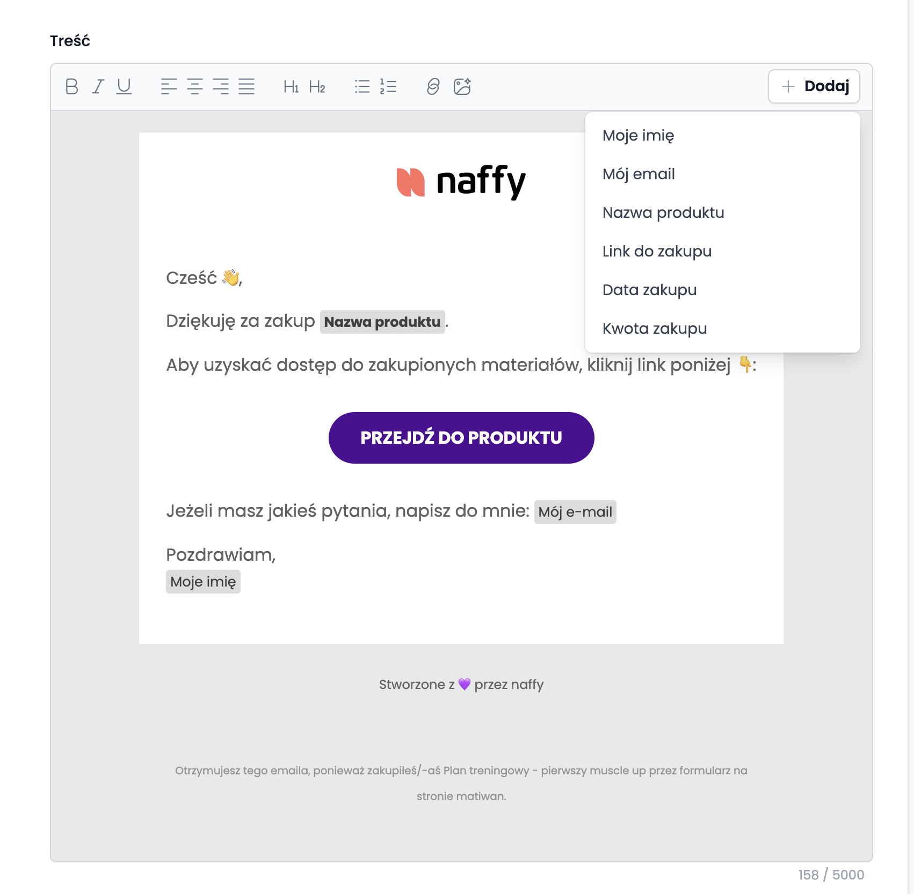

### Tytuł maila pozakupowego:
Twój plan pod pierwszy muscle up czeka na Ciebie 💪

### Treść maila pozakupowego: 

Cześć 👋,

Dziękuję za zakup {{Nazwa produktu}}.

Aby uzyskać dostęp do planu, użyj przycisku „Przejdź do produktu” w tej wiadomości.

## Jak zacząć

1. Pobierz plan i zapisz go w telefonie albo wydrukuj.
2. Trenuj 2–3 razy w tygodniu, z minimum 1 dniem przerwy między sesjami.
3. Pilnuj przerw: 2–3 minuty po każdej serii w części głównej. To dzięki nim ćwiczenia techniczne wychodzą dobrze.
4. Nie wiesz, jak zrobić ćwiczenie? Kliknij jego nazwę w planie albo wejdź do atlasu ćwiczeń: https://matiwan3.github.io/exercises/?lang=pl

## Zanim zaczniesz

Nie skracaj rozgrzewki. Nadgarstki i łopatki muszą być przygotowane na pracę na drążku. Upewnij się też, że drążek jest stabilny, a Ty nie masz przeciwwskazań zdrowotnych. Ćwiczenia wykonujesz na własną odpowiedzialność.

Więcej treningów i wskazówek znajdziesz na moim kanale YouTube: https://www.youtube.com/@matiwann

Jeżeli masz jakieś pytania, napisz do mnie: {{Mój e-mail}}

Pozdrawiam,
{{Moje imię}}

<!-- Zmienne wstaw z menu „Dodaj” w edytorze Naffy: Nazwa produktu, Mój e-mail, Moje imię. Przycisk „Przejdź do produktu” dodaje Naffy automatycznie. Limit treści: 5000 znaków. -->

Przykład

